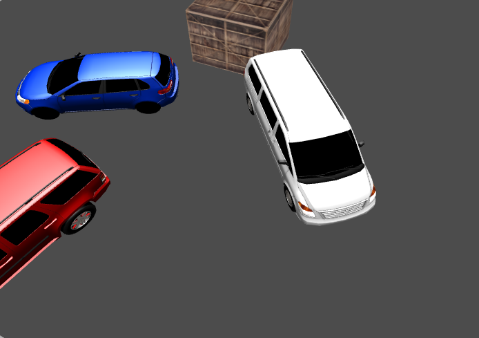
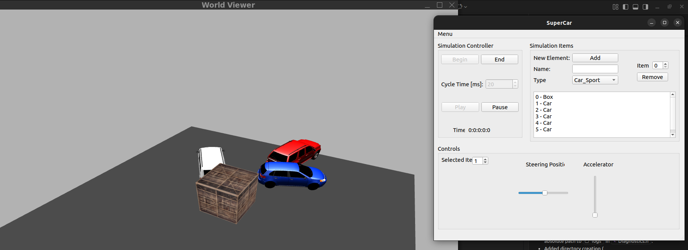
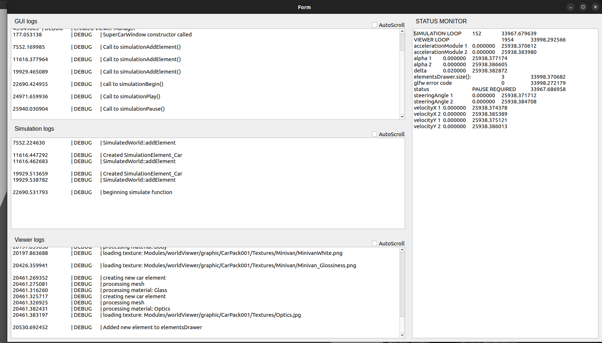

# MCSuperCar

> ⚠️ **Legacy codebase notice**
> This project was originally developed around **2020**. It is a legacy/learning project and parts of the code are intentionally kept as-is, including areas that are not clean by modern production standards.

MCSuperCar is a modular C++ simulation showcase that combines a vehicle simulator, a **3D OpenGL viewer**, and a Qt desktop interface into one integrated application.

It is designed as an engineering-style sandbox where you can:
- simulate dynamic world elements (cars and generic objects),
- render the scene with a custom OpenGL pipeline (mesh import, textures, shaders, camera, transforms),
- interact through a desktop control panel (QT-based),
- and inspect live diagnostics/log outputs while the simulation is running.

## Quick visual preview

<p>
  
</p>
<p>
  
</p>
<p>
  
</p>

### Core modules
- **Simulator** — simulation core and world state management (timing, elements lifecycle, update loop)
- **WorldViewer** — real-time 3D rendering (GLFW/GLAD/OpenGL, meshes, textures, scene/camera handling)
- **GUI** — Qt Widgets frontend to control and observe the application
- **Utilities** — diagnostics, logging, thread-safe helpers, and support utilities

### Why this repo is interesting
- Clean module separation between simulation, rendering, and UI
- **Main focus: OpenGL 3D rendering pipeline** with practical integration of GLFW, GLAD, Assimp, stb, and GLM
- End-to-end 3D flow: import FBX models, load textures, prepare buffers, run shaders, and draw animated scene elements
- Concurrent runtime components with diagnostics and monitoring support
- Includes automated tests for simulation components (GoogleTest)

## Tech stack
- C++17
- CMake
- Qt5 Widgets
- OpenGL + GLFW + GLAD
- Assimp (3D assets)
- Eigen / GLM / stb
- GoogleTest

## Project layout
- `Modules/gui` → Qt desktop application (`MCSuperCar_GUI`)
- `Modules/simulator` → simulation logic and tests
- `Modules/worldViewer` → 3D visualization and scene/drawers
- `Modules/utilities` → diagnostics, queues, OpenGL test app
- `External` → third-party dependencies (vendor/submodule sources)

## Linux setup (Ubuntu/Debian)
Install required packages:

```bash
sudo apt-get update
sudo apt-get install -y \
  build-essential cmake pkg-config git \
  libgl1-mesa-dev libglu1-mesa-dev \
  libwayland-dev wayland-protocols libxkbcommon-dev \
  libxrandr-dev libxinerama-dev libxcursor-dev libxi-dev \
  qtbase5-dev
```

## Get dependencies
If `External/*` folders are empty, initialize dependencies:

```bash
git submodule update --init --recursive
```

If `External/gtests` is missing from submodules in this legacy repo, clone manually:

```bash
git clone https://github.com/google/googletest.git External/gtests
```

## Build
From repository root:

```bash
cmake -S . -B build
cmake --build build -j
```

## Run
Launch the GUI app:

```bash
./build/Modules/gui/MCSuperCar_GUI
```

Optional test executable:

```bash
./build/Modules/simulator/SimulatorTester
```

## Known legacy notes
- Some runtime paths are Windows-style absolute paths in legacy code (textures/log files), so on Linux you may see messages like `Failed to load texture`.
- This does not necessarily prevent startup; the GUI can still open.
- Logs are written to the local `logs/` folder in the project root.

## Troubleshooting
- If CMake fails on OpenGL: ensure Mesa dev packages are installed.
- If CMake fails on Qt: ensure `qtbase5-dev` is installed.
- If CMake fails because `External/*` has no `CMakeLists.txt`: make sure dependencies were fetched (`git submodule update --init --recursive`).
- If GLFW fails with Wayland/X11 headers missing: install the listed `libwayland-dev`, `libxkbcommon-dev`, and X11 dev packages.
